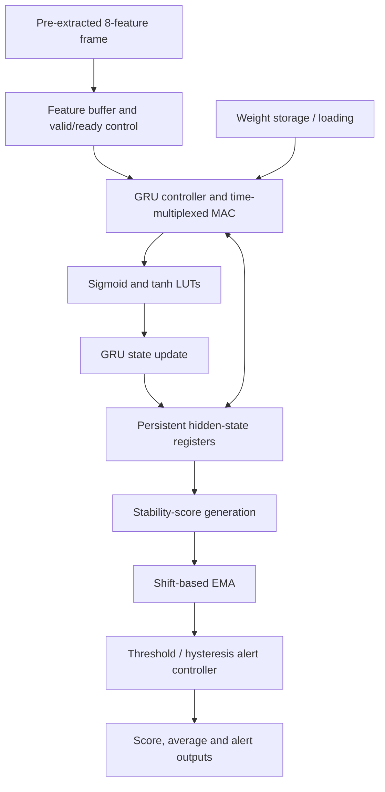
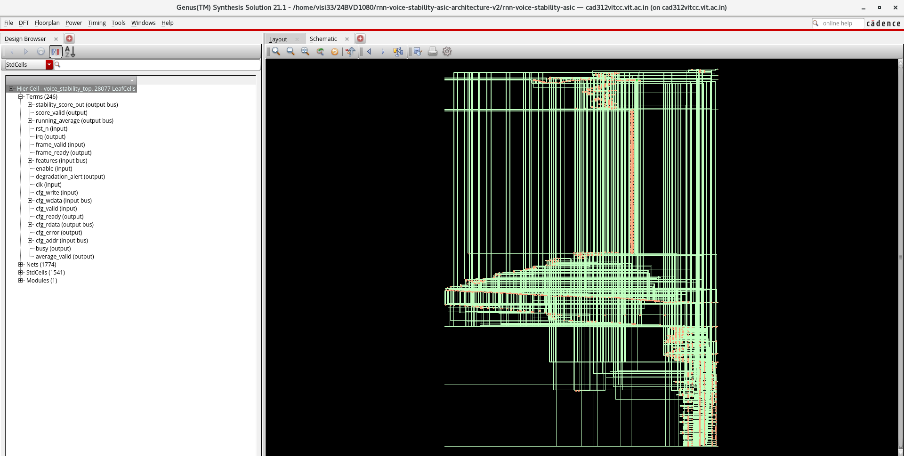
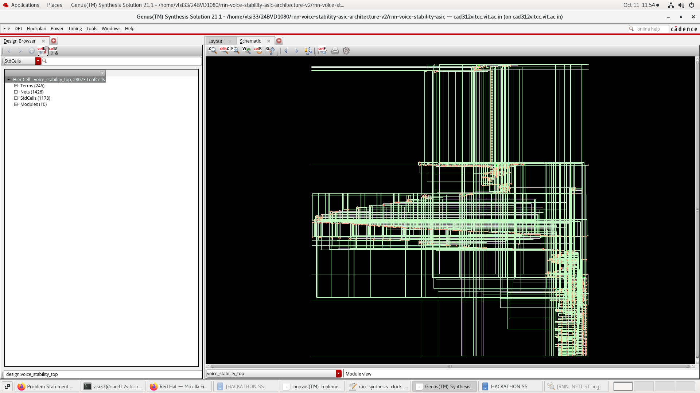
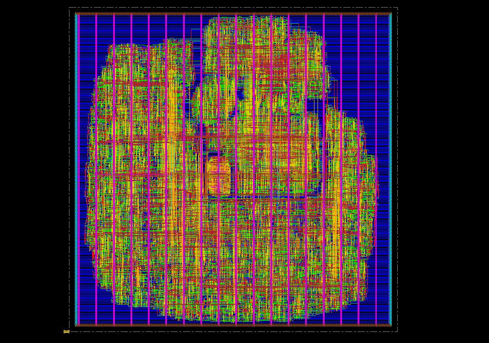

# RNN-Based Voice Stability Monitor ASIC

### PS-01 · Telecom Edge Device · VLSI Hackathon 2026

**Team 15** — Gokulraj (24BVD1080) · Surya Narayanan (24BVD1022)

**Implementation environment:** Cadence Xcelium · Cadence Genus · Cadence Innovus · GPDK90  
**Top-level RTL module:** `voice_stability_top`  
**Repository:** https://github.com/gokhss/rnn-voice-stability-asic

---

## Project overview

The RNN-Based Voice Stability Monitor is a hardware accelerator prototype for continuous, edge-side monitoring of voice-quality stability. It processes pre-extracted feature frames, preserves temporal context with a gated recurrent unit (GRU), computes a frame-level stability score, smooths the score over time, and raises an alert when the configured degradation condition is met.

The design targets telecom edge equipment where voice-quality monitoring should operate locally without depending on a cloud service. Microphone capture, codec implementation, and feature extraction are outside the accelerator boundary.

The design uses a time-multiplexed multiply–accumulate (MAC) datapath to reuse arithmetic hardware across recurrent computations. A clock-gated implementation was synthesized and physically implemented in the GPDK90 environment using Cadence tools.

> **Prototype and validation scope:** This is an RTL and physical-design prototype, not a tape-out signoff package. The supplied report documents functional reference-to-RTL comparisons, Genus synthesis estimates, Innovus routing results, and GDSII export. However, the Conformal comparison reported non-equivalent and aborted points, and independent LVS/foundry signoff are not established. See [Validation status and limitations](#validation-status-and-limitations).

## Highlights

- Eight input features per frame and a 16-state GRU.
- INT8 weights and INT16 activation datapaths.
- Time-multiplexed MAC architecture.
- Sigmoid and tanh lookup-table approximations.
- Persistent recurrent hidden state with reset/flush handling.
- Frame-level stability score, shift-based exponential moving average (EMA), and programmable alert/hysteresis behavior.
- Cadence Xcelium verification against a Python reference.
- Cadence Genus synthesis comparison: original versus clock-gated design.
- Cadence Innovus floorplanning, placement, clock-tree synthesis, routing, RC extraction, and GDSII stream-out.

## Architecture



## Cadence implementation screenshots

The following screenshots show the original Genus netlist view, the clock-gated Genus netlist view, and the post-routing physical-design view.

### Original RNN netlist — Cadence Genus



### Clock-gated RNN netlist — Cadence Genus



### Post-routing physical design — Cadence Innovus



> **Note:** These are tool screenshots for visual documentation. Refer to the synthesis and post-route reports below for the reported quantitative metrics.

### GRU equations

The report describes a reset-before GRU. The update and reset gates are computed as:

\[
z_t = \sigma(W_z x_t + U_z h_{t-1} + b_z)
\]

\[
r_t = \sigma(W_r x_t + U_r h_{t-1} + b_r)
\]

\[
n_t = \tanh(W_n x_t + U_n(r_t \odot h_{t-1}) + b_n)
\]

\[
h_t = z_t \odot h_{t-1} + (1-z_t) \odot n_t
\]

The updated hidden state feeds the score-generation and smoothing stages. The alert logic uses the smoothed score and configured threshold/hysteresis behavior. The exact fixed-point scaling, rounding, saturation, handshake timing, and reset semantics should be taken from the RTL and the associated design documentation.

## Hardware and implementation configuration

| Parameter | Reported configuration |
|---|---|
| Network | Single-layer GRU |
| Input feature count | 8 |
| Hidden-state width | 16 |
| Weight precision | INT8 |
| Activation precision | INT16 |
| Arithmetic architecture | Time-multiplexed MAC |
| Nonlinear functions | Sigmoid and tanh LUT approximations |
| Smoothing | Shift-based EMA |
| Alert behavior | Configurable threshold/hysteresis |
| Technology | GPDK90 |
| Synthesis | Cadence Genus |
| Simulation / RTL verification | Cadence Xcelium |
| Physical design | Cadence Innovus 21.15 |
| Timing-analysis context | 10 MHz implementation target used in the report |
| Nominal frame interval for stream-length calculation | 20 ms |

## Repository layout

The project repository is:

```text
rnn-voice-stability-asic/
├── rtl/                 # SystemVerilog design
├── tb/                  # RTL testbenches and test vectors
├── model/               # Python reference model and numerical utilities
├── docs/                # Problem statement, architecture and flow documentation
├── scripts/             # Simulation and Cadence implementation scripts
├── constraints/         # Timing and physical-design constraints
├── config/              # Project parameters and technology configuration example
├── reports/             # Generated reports when available; may be ignored by Git
├── build/               # Generated implementation artifacts; may be ignored by Git
├── Makefile
├── .gitignore
├── LICENSE
└── README.md
```

Generated implementation data may reside on the implementation workstation rather than in the public Git repository. Do not assume that large PDK-dependent databases, extracted parasitics, or GDSII files are tracked or downloadable from GitHub.

## Cadence design flow

This project is developed for a Cadence-based ASIC environment. The main tools are:

| Tool | Role |
|---|---|
| Cadence Xcelium | SystemVerilog simulation and RTL/reference comparison |
| Cadence Genus | Logic synthesis and original-versus-clock-gated synthesis comparison |
| Cadence Innovus | Floorplanning, power-grid setup, placement, CTS, routing, extraction and stream-out |
| Cadence Tempus / timing reports | Static timing analysis, where configured in the local environment |
| GPDK90 | Technology library used for the reported prototype |

The Cadence tools and GPDK90 technology files are licensed or environment-dependent resources; they are not included in this repository. Commands and setup scripts must be run from a machine with the correct Cadence release, licenses, library files, and local configuration.

### 1. RTL simulation with Xcelium

Use the repository's simulation script or the team's configured Xcelium invocation. For example, the direct simulator invocation pattern is:

```bash
xrun -64bit -sv \
  -f <your_xcelium_filelist> \
  -top voice_stability_top
```

`<your_xcelium_filelist>` is a placeholder for the actual source/testbench file list used by your environment. Use the project's existing script and testbench setup where available; do not assume that this illustrative command alone runs the full regression.

The report documents:
- 26 passing Python model/unit tests.
- Exact Python-reference versus Xcelium RTL comparison on 256 frames.
- Exact comparison over 180,000 consecutive frames, representing one hour at a nominal 20 ms per frame.
- Coverage of selected reset/flush, state restart, weight-loading, backpressure, repeated-frame, and alert/control scenarios.

These are the results documented in the team's report; rerun the tests and preserve fresh logs when reproducing the result from a particular Git commit.

### 2. Synthesis with Genus

The report compares the original design with a clock-gated version synthesized against the GPDK90 typical library. The primary synthesis results are:

| Metric | Original RNN | Clock-gated RNN |
|---|---:|---:|
| Mapped cells | 28,077 | 28,023 |
| Standard-cell area | 333,659.685 µm² | 300,063.923 µm² |
| Estimated total power | 4.00463 mW | 1.82127 mW |
| Setup slack at 10 MHz | +90.116 ns | +89.259 ns |
| Integrated clock-gating cells | — | 1,281 |

The report calculates a **54.52% reduction in synthesis-stage estimated power** and approximately **10.07% lower mapped cell area** for the clock-gated version. These values are tool estimates under the report's power-estimation assumptions, not silicon measurements or SAIF-calibrated measurements.

### 3. Physical implementation with Innovus

The report documents a GPDK90 physical-design run with floorplanning, approximately 60% target placement density, standard-cell placement, VDD/VSS routing, clock-tree synthesis, detailed routing, and parasitic RC extraction.

The reported clock-gated post-route observations are:

| Metric | Reported result |
|---|---:|
| Mapped/placed instances in exported layout | 28,280 |
| Placement density | 60.263% |
| Setup WNS | +86.507 ns |
| Setup TNS | 0.000 ns |
| Setup violating paths | 0 |
| Max capacitance / transition / fanout DRVs | 0 / 0 / 0 |
| Innovus routed DRC violations | 0 |
| Connectivity violations | 0 |
| Post-route estimated power | 2.464 mW |
| Internal power | 0.7708 mW |
| Switching power | 0.2501 mW |
| Leakage power | 1.443 mW |
| Estimated clock-network power | 0.3663 mW |

The post-route power number uses a physically implemented clock network and different analysis assumptions from the Genus synthesis estimates. It should not be compared directly with the original design's 4.00463 mW synthesis estimate as if both were measured at the same implementation stage.

### 4. Reported implementation artifacts

The report lists the following outputs on the implementation server:

| Artifact | Reported location |
|---|---|
| Merged GDSII, approximately 30 MB | `build/clock_gated_pnr/voice_stability_top_merged.gds` |
| Post-route DEF | `build/clock_gated_pnr/voice_stability_top_postroute.def` |
| Post-route gate-level Verilog | `build/clock_gated_pnr/voice_stability_top_postroute.v` |
| Post-route SPEF | `build/clock_gated_pnr/voice_stability_top_postroute.spef` |
| Routed Innovus checkpoint | `build/clock_gated_pnr/clock_gated_routed_final.enc.dat` |
| Post-route power report | `reports/clock_gated_postroute_power.rpt` |
| Post-route timing reports | `reports/clock_gated_postroute/` |

These are paths recorded in the report, not promises that the files are present in the public repository. They may exist only on the team's Cadence implementation workstation.

## Verification and numerical results

### Reference-model and RTL checks

| Check | Reported result |
|---|---|
| Python model unit tests | 26 passed |
| Python / RTL bit-accurate comparison | Exact match for 256 frames |
| Continuous Python / RTL comparison | Exact match for 180,000 frames |
| Nominal frame interval used for long stream | 20 ms |
| Long-stream equivalent duration | 3,600 seconds (one hour) |
| Simulated frame-processing latency | 1,380 cycles |
| Clock used for latency calculation | 10 MHz |
| Calculated processing latency | 0.138 ms |

The 180,000-frame test is a simulated one-hour-equivalent stream; it does not mean the simulator ran for one hour in wall-clock time. The 0.138 ms result is calculated from 1,380 cycles at 10 MHz. It is not a silicon measurement.

### Nonlinear approximation and numerical comparison

| Metric | Reported result |
|---|---:|
| Sigmoid LUT maximum absolute error | 0.0020449 |
| Tanh LUT maximum absolute error | 0.0078670 |
| Frames in numerical-format comparison | 1,024 |
| Mean absolute hardware-versus-float score difference | 0.0009851 |
| Maximum absolute hardware-versus-float score difference | 0.0022038 |

The floating-point comparison uses a synthetic, deterministic, **untrained** numerical prototype. These errors do not establish trained voice-quality prediction accuracy or correlation against MOS/PESQ or another labeled perceptual-quality metric.

## Validation status and limitations

The results above are transcribed from the team's technical report and should be interpreted within the stated validation scope.

- **Conformal equivalence:** The report records 747 equivalent points, 11,774 non-equivalent points, and one aborted compared point. Therefore, the clock-gated netlist is **not claimed to be formally equivalent** to the golden/original netlist. Investigate and resolve the non-equivalent and aborted points before making an equivalence claim.
- **DRC and connectivity:** The report records zero Innovus routed DRC violations and zero connectivity violations in the reported physical-design run. These results do not by themselves establish foundry signoff DRC.
- **LVS:** Independent LVS completion is not evidenced in the report.
- **GDSII:** The report states that Innovus stream-out generated a merged GDSII file of approximately 30 MB. Stream-out is a layout-delivery milestone, not proof of tape-out readiness.
- **Power:** The power figures are EDA estimates under their respective assumptions, not measured chip power.
- **Voice-quality accuracy:** The model weights are deterministic and untrained. A representative labeled dataset, training/calibration, and task-level validation are still required.
- **Signoff:** The reported flow is a physical prototype, not a complete tape-out signoff package. Technology-specific signoff, library/reference checks, and independent LVS remain outside the claims made here.

## Hackathon deliverables mapping

The official PS-01 deliverables ask for synthesizable RTL and build instructions, a verification package, an implementation report, a design document, and a demonstration.

| Deliverable | Repository / evidence |
|---|---|
| RTL source and build instructions | `rtl/`, project scripts, this README |
| Verification package | `tb/`, `model/`, test vectors, simulation logs |
| Implementation report | Synthesis and Innovus results documented above and in the submitted report |
| Design document | Architecture, block diagram, numeric-format rationale, register/interface description, and trade-off discussion |
| Demonstration | Xcelium simulation or FPGA demonstration, plus a 10-minute technical presentation |

Before final submission, ensure the README, source revision, logs, and report refer to the same implementation snapshot. Keep the main design document within the organizer's stated maximum of 10 pages if that limit applies to the design document separately from its evidence appendix.

## Team

| Name | Register number |
|---|---|
| Gokulraj | 24BVD1080 |
| Surya Narayanan | 24BVD1022 |

## License and third-party dependencies

See [`LICENSE`](LICENSE) for the repository's source-code license. Cadence tools, GPDK90 technology data, standard-cell libraries, and other licensed EDA/PDK assets are not included in the source repository and are not granted by the project license.

## Cadence Implementation Screenshots

### Original RNN Netlist — Cadence Genus


### Clock-Gated RNN Netlist — Cadence Genus


### Post-Routing Physical Design — Cadence Innovus


