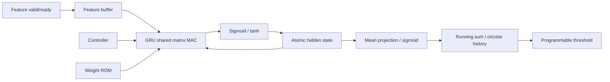

# PS-01 — RNN-Based Voice Stability Monitor

**RTL implementation update:** The INT8/F12 target and CSR loader are now implemented. Run `make test`; see [verified results, interface migration and limitations](docs/rtl_implementation_report.md). Prototype descriptions and examples below are historical where they differ from that report. No trained accuracy or physical PPA is claimed.

A resource-shared SystemVerilog GRU accelerator for per-frame, pre-extracted
voice-quality features. It retains recurrent state, produces a normalized
stability score, averages recent frames, and flags a configurable threshold.

**Current Phase 0/1 review:** Start with the [phase review and approval gate](docs/architecture_review.md), [current repository audit](docs/phase0_audit.md), [local research-paper review](docs/research_paper_review.md), and [GRU mathematical specification](docs/gru_mathematical_specification.md). The [architecture proposal](docs/final_architecture.md) and [requirement matrix](docs/requirements_traceability.csv) link the detailed contracts. Earlier result tables below are historical; current execution evidence is in the phase review. Phase 2 requires explicit approval.

**Status:** architecture contract revised against PS-01. The RTL in this ZIP is still a prototype and is not yet fully compliant; see [known gaps](docs/architecture.md#9-known-prototype-gaps-to-fix) and the [migration checklist](docs/architecture_migration.md). RTL simulation/lint and ASIC implementation stages are not established as passing. No netlist, physical measurements, GDSII, or signoff results are claimed.

Original problem: design a low-power RTL accelerator that runs a small recurrent
neural network layer on per-frame voice-quality features and produces a running
average stability score. A telecom edge device uses it to monitor live calls and
flag degradation without a cloud service. Feature extraction, microphone input,
and audio codecs are outside the accelerator. See [specification](docs/problem_statement.md), the [target architecture](docs/architecture.md), and the [migration checklist](docs/architecture_migration.md).

Demonstration weights are deterministic and **untrained**. Scores are for
hardware verification and have no established real-world predictive validity.
Training, calibration, and representative voice-quality datasets are required.

## Hardware specifications

| Item | Baseline |
|---|---|
| Network | Single-layer reset-before GRU |
| Target feature / hidden dimensions | 8 / 16 initially; parameterized within 8–16 / 16–32 |
| Numeric format | Signed INT8 weights; signed INT16 activations/state with documented scaling |
| Matrix datapath | Shared MAC, signed 40-bit accumulator |
| Activations | Saturating piecewise linear sigmoid/tanh |
| Weight storage | Constant combinational ROM |
| Output score / threshold | Unsigned Q0.16, 65535 represents just below 1 |
| Average | Target: shift-based divider-free EMA; current prototype still uses a circular mean |
| Clock | 50 MHz target, not measured |
| Reset | Synchronous active-low |
| Input | Packed vector with valid/ready |
| Enable | Stops admission; accepted frames complete |

INPUTS, HIDDEN and MAX_WINDOW are elaboration parameters. Width remains fixed
at 16 bits to keep Q4.12 activation constants well defined. Runtime window
changes reset the history; zero clamps to one and excessive values clamp to
MAX_WINDOW. This adds programmable averaging to the baseline window of 16.
The current RTL has not yet been migrated to the target INT8/EMA/AXI-Stream architecture. No low-power, area, or timing result has been established.

## Architecture and equations



```
z = sigmoid(Wz*x + Uz*h + bz)
r = sigmoid(Wr*x + Ur*h + br)
n = tanh(Wn*x + Un*(r .* h) + bn)
h_next = z .* h + (1-z) .* n
score = sigmoid(mean(h_next))
alert = average_initialized && (running_average < threshold)
```

Reset-before is intentional: r multiplies the old hidden vector before the
candidate recurrent matrix. Hidden states commit together after all neurons
finish. Rounding is nearest, ties away from zero; narrowing saturates. Equality
to threshold never alerts. [Numerical details](docs/gru_mathematics.md) and
[architecture/interface timing](docs/architecture.md) define all quantization
points and sequencing.

| RTL file | Purpose |
|---|---|
| voice_stability_top.sv | Valid/ready admission and output pipeline |
| gru_controller.sv | Gate, neuron, term and commit FSM |
| feature_buffer.sv | Capture accepted features |
| gru_cell.sv | Gates, candidate and hidden update |
| mac_unit.sv | Wide multiply/accumulate and conversion |
| sigmoid_lut.sv | Bounded PWL sigmoid |
| tanh_lut.sv | Bounded PWL tanh from sigmoid identity |
| weight_rom.sv | Reproducible constant coefficients |
| hidden_state_reg.sv | Persistent atomic state register |
| stability_score.sv | Mean-state projection and sigmoid |
| moving_average.sv | Circular history and running sum |
| alert_controller.sv | Qualified strict threshold comparison |

Feature zero is bits [15:0]; each feature is independently signed. Frame
acceptance occurs on a rising edge with frame_valid && frame_ready. Output
score_valid and average_valid are separate one-cycle strobes; average_valid
follows score_valid by one cycle. Configuration must be synchronous. busy
includes computation and score drain. Reset aborts an in-flight frame. See
[top-level RTL](rtl/voice_stability_top.sv) for the complete port list.

## Repository

The supplied project contains source, configuration, documentation and the
deterministic vector fixture. Git tracking metadata is unavailable in this
workspace, so a tracked-file count is not asserted. Generated outputs are ignored.

```text
rnn-voice-stability-asic/
|-- README.md
|-- LICENSE
|-- .gitignore
|-- Makefile
|-- docs/
|   |-- problem_statement.md
|   |-- architecture.md
|   |-- gru_mathematics.md
|   `-- rtl_to_gds_flow.md
|-- rtl/
|   |-- voice_stability_top.sv
|   |-- gru_controller.sv
|   |-- feature_buffer.sv
|   |-- gru_cell.sv
|   |-- mac_unit.sv
|   |-- sigmoid_lut.sv
|   |-- tanh_lut.sv
|   |-- weight_rom.sv
|   |-- hidden_state_reg.sv
|   |-- stability_score.sv
|   |-- moving_average.sv
|   `-- alert_controller.sv
|-- tb/
|   |-- tb_voice_stability_top.sv
|   |-- tb_gru_cell.sv
|   |-- tb_moving_average.sv
|   |-- test_vectors.mem
|   `-- README.md
|-- model/
|   |-- gru_reference.py
|   |-- quantize.py
|   |-- generate_weights.py
|   `-- requirements.txt
|-- scripts/
|   |-- run_sim.sh
|   |-- run_lint.sh
|   |-- run_synthesis.tcl
|   |-- run_sta.tcl
|   |-- run_pnr.tcl
|   |-- run_drc_lvs.sh
|   `-- report_qor.py
|-- constraints/
|   |-- top.sdc
|   `-- floorplan.tcl
|-- config/
|   |-- parameters.mk
|   `-- tech_config.example.mk
`-- .github/workflows/rtl-ci.yml
```

Ignored build/, reports/, waveforms/, and gds/ are created by the commands.
An optional ignored config/tech_config.mk contains private machine configuration.
The project resides in its own folder; use that folder as the GitHub repository
root so the workflow and relative paths resolve correctly.

## Dependencies and simulation

Python >=3.6, Bash, GNU Make and ripgrep; no Python packages are needed.
RTL simulation requires Icarus Verilog with SystemVerilog support (recommended
11+), Verilator 5+ (`--binary --timing`), or licensed Xcelium (`xrun`). Full lint
uses Verilator; Icarus fallback performs syntax/elaboration checks only.

From a fresh checkout:

```bash
make help
make model                      # Runs Python checks, writes weights and vectors
make sim                        # Auto-detect simulator, runs all three benches
SIM=iverilog make sim
SIM=verilator make sim
SIM=xrun make sim
make lint
make test                       # Model + all benches + lint; verification marker
make reports                    # Evidence summary in reports/qor.json
```

`make model` regenerates tb/test_vectors.mem reproducibly and writes
build/weights.tsv and reports/model.json. Exact bit comparisons cover 128
stateful frames including extreme inputs, reset, backpressure, invalid cycles,
startup/wrapping/reconfiguration, threshold equality and assertion/deassertion.
The cell bench checks hidden states, MAC ties/saturation and every activation
input. Waveforms are waveforms/top.vcd, cell.vcd and average.vcd. A watchdog and
explicit PASS-line checks catch missing completion. See [test guide](tb/README.md).

Python verification executed locally on Python 3.6.8:

| Check | Actual result |
|---|---|
| Integer rounding/saturation, state persistence, average startup | PASS |
| Exhaustive sigmoid error, all 65,536 signed inputs | Max absolute error 0.01807698997125361 |
| Exhaustive tanh error, all 65,536 signed inputs | Max absolute error 0.03614531386627384 |
| Python syntax compilation | PASS |
| Bash script syntax checks | PASS |
| RTL simulation / lint | Historical run blocked; current audit finds Icarus/Verilator, but no RTL run was performed |

These Python results validate the software numerical contract, not the RTL.
CI is configured to install Icarus and Verilator and run `make test reports`;
CI has not been executed in this workspace.

## Synthesis and physical implementation

Genus, Tempus and Innovus require licensed local installations and actual
PDK-qualified Liberty, technology/cell LEF, QRC technology, cell GDS and stream
map. DRC/LVS require supported tools and licensed decks via executable wrappers.
Nothing modifies system installations or requires sudo in local project scripts.

```bash
cp config/tech_config.example.mk config/tech_config.mk
# Edit ignored tech_config.mk with your actual local resources.
make test
make synth                      # Also reruns verification before Genus
make sta                        # Requires existing mapped netlist/SDC
make pnr                        # Requires mapped design and physical libraries
make sta                        # Uses routed netlist/SPEF when available
make gds                        # Runs PnR, then configured DRC/LVS wrappers
make reports
```

Synthesis writes build/voice_stability_top_mapped.v, mapped SDC, database and
reports/synth_*.rpt. Innovus runs floorplanning/PG/pins, placement, CTS,
routing/post-route optimization, RC extraction, reports, database, routed
netlist and gds/voice_stability_top.gds. Tempus reports setup/hold paths,
violations and analysis summary. The exported GDS is a candidate deliverable
until actual signoff reports are reviewed. `make gds` requires wrappers that
fail on violations/mismatches; they must write reports/drc.rpt and lvs.rpt.

Cadence scripts are **unexecuted release-dependent templates**. Configure and
validate every command against the installed release and technology. The
example flow uses a nominal RC/timing corner, not full multi-corner signoff.
Power without measured switching activity is a tool-default estimate. Cell
filler/tap/decap/endcap insertion, antenna repair, metal fill, pad integration,
foundry-specific PG dimensions and full MMMC signoff remain PDK integration
work; no generic script can supply qualified choices. See
[flow guide](docs/rtl_to_gds_flow.md). No screenshots are available without PnR
and graphical access. `make clean` removes only generated artifact directories.

## Implementation results

| Metric | Result |
|---|---|
| Clock frequency | NOT MEASURED; constraint target 50 MHz |
| Input features | 8 |
| Hidden neurons | 8 |
| Numerical precision | 16-bit Q4.12 |
| Cell area | NOT RUN — synthesis blocked |
| Total cell count | NOT RUN |
| Power | NOT RUN |
| Worst negative slack | NOT RUN — STA blocked |
| Total negative slack | NOT RUN |
| Setup / hold violations | NOT RUN |
| Processing latency | NOT MEASURED; analytical baseline 442 cycles to score_valid |
| Frame throughput | NOT MEASURED |
| DRC violations | NOT RUN |
| LVS status | NOT RUN |
| Final GDSII | NOT GENERATED |

## Limitations and next steps

Run the approved verification plan before accepting RTL correctness (Icarus and
Verilator were found during the Phase 1 audit). Then supply the
actual tool/technology configuration to validate synthesis and implementation.
Train and evaluate weights on labeled voice-quality data; the current mean-state
projection is only a demonstration. Future work includes formal assertions,
coverage, quantization-aware training, score calibration, clock/power gating,
constant-window divider optimization, tighter auxiliary multiplier sharing,
serial feature ingress and PDK-qualified multi-corner physical signoff.

MIT licensed; see [LICENSE](LICENSE). Proprietary PDKs, EDA tools and libraries
are not included or covered by this license.
