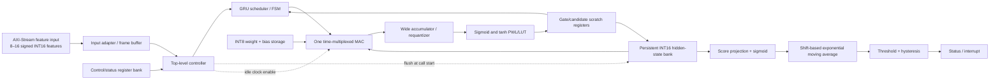

# PS-01 Architecture v2 — RNN-Based Voice Stability Monitor

## Status and scope

This document defines the **corrected target architecture** for the hackathon specification. It is the architecture contract to implement against; it is not a claim that the current RTL already satisfies every item. The existing source is a prototype and must be brought into conformance module-by-module. Do not report PPA or verification as passing until the corresponding tools have run and reports have been inspected.

## 1. Top-level block diagram

Audio capture, codec operation, and extraction of jitter/packet-loss/energy/SNR/spectral features are outside this accelerator. The input is a precomputed feature vector for each frame.

## 2. Required baseline configuration

| Parameter | Architecture target |
|---|---|
| Input features | Parameterized 8–16; initial implementation uses 8 |
| Recurrent layer | One GRU layer |
| Hidden units | Parameterized 16–32; initial implementation uses 16 |
| Weights | Signed INT8, range −128…127 |
| Activations/state | Signed INT16 fixed point; format and scaling documented per tensor |
| Accumulation | Wider signed accumulator; at least 40 bits, with explicit overflow analysis |
| Compute | One shared/time-multiplexed MAC datapath; no fully parallel matrix engine |
| Nonlinearities | Sigmoid and tanh by LUT or piecewise-linear approximation |
| State | Retained between frames; explicit `flush_state` clears it at call start |
| Score | Unsigned normalized score in [0, 1], with documented encoding |
| Averaging | Shift-based exponential moving average (EMA), no variable divider |
| Alert | Programmable low threshold, separate recovery threshold/hysteresis |
| Input cadence | One feature frame every 10–20 ms |
| Compute latency | Less than 1 ms from accepted frame to completed score |
| Idle power | Stop unnecessary state updates; use supported integrated clock-gating methodology for implementation |

The initial dimensions (8 inputs, 16 hidden units) are a resource-conscious starting point, not a relaxation of the specified ranges. The trained model must determine the actual weights. Deterministic demonstration coefficients may be used during early RTL bring-up only and must not be presented as a voice-quality predictor.

## 3. Datapath and numerical contract

1. Accept and latch one feature frame only when `s_axis_tvalid && s_axis_tready` is true.
2. Store features as signed INT16 values. Feature normalization and input quantization must be identical in the Python golden model and RTL.
3. Store each GRU weight as signed INT8. Store biases in a separately documented format; do not silently treat arbitrary 16-bit coefficients as INT8 weights.
4. Multiply signed INT16 activations by signed INT8 weights. Accumulate products in a wide signed accumulator; define the accumulator bound, bias alignment, rounding, saturation, and requantization points.
5. Compute GRU update/reset/candidate gates in the exact convention selected by the Python model. Do not change the update-gate convention between training, reference, and RTL.
6. Use a shared MAC under an FSM. Gate/neuron/term indices and scratch registers are reused across cycles. The scheduler must account for every dependency in the reset-before candidate computation.
7. Use LUT/PWL activation functions with bounded input domains. Record maximum absolute error against mathematical sigmoid/tanh and test the full signed input domain or a justified exhaustive subset.
8. Commit the complete next hidden vector atomically after all neurons finish. Keep the old hidden state available during the current frame's calculations.
9. Generate a normalized score from the new hidden state. The score's integer encoding and saturation endpoints must be documented and consistent across Python and RTL.

### Latency budget

At the required 50 MHz example clock, the 1 ms frame-compute limit corresponds to 50,000 clock cycles. The controller's worst-case accepted-frame-to-score latency must be measured in simulation and checked against this limit. The 10–20 ms input interval is not itself the compute latency target. A 1-hour continuity regression contains 180,000 frames at 20 ms or 360,000 frames at 10 ms.

## 4. Averaging and alert architecture

Use an EMA rather than a variable-length circular sum/division:

`avg_next = avg + round_shift(score - avg, alpha_shift)`

where `alpha_shift` is programmable and constrained to a supported range. The subtraction is signed and wider than the score; rounding, signed right-shift behavior, and saturation are explicit. There must be no `/` operator or inferred variable divider in this datapath.

Use a latched alert with hysteresis:

- Set alert when the average falls below `assert_threshold`.
- Clear alert only when the average rises above `recover_threshold`, where `recover_threshold > assert_threshold`.
- Define behavior for threshold reconfiguration and state flush.
- Raise an interrupt/status bit on the configured alert transition; software clears a sticky status bit using the documented register protocol if sticky status is implemented.

The moving-average module in the prototype currently uses a circular history and `new_sum/new_count`, which can infer division. The prototype alert is a combinational strict threshold comparison and therefore lacks hysteresis. Both must be replaced before claiming compliance.

## 5. External interfaces

### AXI-Stream feature input

Implement a standard ready/valid transfer for a packed feature vector, with `s_axis_tvalid`, `s_axis_tready`, and `s_axis_tdata`. Add `s_axis_tlast` only if the chosen framing convention needs it; one accepted transfer should represent one complete frame. The design must tolerate backpressure and must not overwrite an accepted frame while busy.

The prototype's `frame_valid`/`frame_ready` pair is a local handshake, not an AXI-Stream interface. It may be retained internally behind an AXI-Stream adapter.

### Control/status register bank

Provide a documented memory-mapped register interface (AXI-Lite or a simple register bus if the hackathon allows it) with at least:

| Register | Required behavior |
|---|---|
| CONTROL | Enable, state flush request, interrupt enable |
| ASSERT_THRESHOLD | Low-quality threshold that sets alert |
| RECOVER_THRESHOLD | Hysteresis recovery threshold |
| EMA_SHIFT | Configurable shift controlling EMA smoothing |
| STATUS | Busy, frame done, alert, overflow/saturation/error flags as implemented |
| WEIGHT_LOAD | Mechanism to load trained INT8 weights/biases, or explicitly documented preloaded ROM if loading is not required by the review |

All multi-bit controls must be sampled synchronously. Define whether a control write is accepted during active computation. `flush_state` must clear recurrent state at the start of a call without requiring a full chip reset; it must also define what happens to an in-flight frame.

## 6. Reset, flush, and power behavior

- Reset is synchronous active-low in the current project; retain it unless the integration environment specifies otherwise.
- Reset clears control state, valid strobes, alert state, recurrent state, and averaging state.
- `flush_state` clears recurrent hidden state at a call boundary. Define separately whether EMA/alert history also clears; the default recommendation is to clear both hidden and per-call average/alert state when a new call begins.
- An accepted frame always completes unless reset or an explicitly defined abort occurs.
- Idle gating must not gate clocks using arbitrary combinational logic. Prefer clock enables in RTL; let synthesis/physical implementation insert integrated clock-gating cells where supported.

## 7. RTL module boundaries

| Module | Responsibility |
|---|---|
| `voice_stability_top` | AXI-Stream adapter, register bus, frame admission, score/interrupt interface |
| `feature_buffer` | Latch one accepted frame |
| `gru_controller` | Schedule gate, neuron, term, and atomic commit operations |
| `gru_cell` | GRU datapath and scratch state |
| `mac_unit` | Signed INT16 × INT8 multiply, wide accumulation, rounding/saturation |
| `weight_rom` / weight RAM | Trained INT8 weights and documented biases |
| `sigmoid_lut`, `tanh_lut` | PWL/LUT nonlinearities |
| `hidden_state_reg` | Persistent hidden state with explicit flush and atomic commit |
| `stability_score` | Convert hidden state into normalized Q0.16 score |
| `moving_average` | Divider-free shift-based EMA |
| `alert_controller` | Hysteretic alert state and interrupt/status event |
| Python model | Training/export, fixed-point oracle, error analysis and vector generation |

## 8. Verification acceptance criteria

Do not mark the architecture complete until the following pass:

1. Python floating-point, quantized Python, and RTL use the same GRU equations and parameters.
2. Exact integer/bit-accurate comparisons at all specified checkpoints; floating-point-to-fixed-point loss reported separately.
3. INT8 range assertions on every exported weight; overflow/saturation counters or assertions where appropriate.
4. Exhaustive or well-justified sigmoid/tanh approximation error analysis.
5. Reset during a call, explicit flush, saturated inputs, back-to-back frames, backpressure, threshold assertion and hysteretic recovery.
6. One-hour-equivalent stateful stream (180,000 frames at 20 ms or 360,000 at 10 ms), with state continuity and no dropped/duplicated accepted frames.
7. Measured accepted-frame-to-score latency <1 ms under a declared clock and simulator conditions.
8. Synthesis reports for area/timing and a documented power-estimation method with switching activity. Do not claim low-milliwatt power from RTL simulation alone.
9. If physical design is performed: post-route timing, power, area, and applicable physical verification reports using a named PDK/library.

## 9. Known prototype gaps to fix

The current repository source is a prototype and is not yet conformant in these areas: default hidden dimension is 8; weights and MAC weight ports are 16-bit and generated demonstration coefficients exceed INT8; state flush is absent; moving average uses a variable divide; alert lacks hysteresis; AXI-Stream and a complete register map are absent; weights are deterministic and untrained; the top test only runs 128 frames; and simulator/synthesis/PPA evidence is not currently established. These are implementation tasks, not items to describe as already completed.
