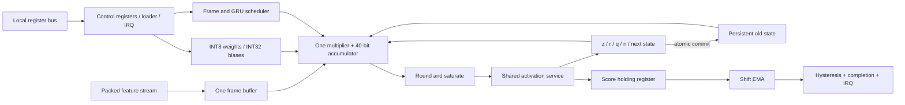

# Final architecture proposal — approval required

## Authority, evidence and phase boundary

PS-01 in [problem_statement.md](problem_statement.md) is authoritative. [Research review](research_paper_review.md) identifies the paper-supported recurrence and research limitations; [mathematical specification](gru_mathematical_specification.md) fixes the project's bias-enabled reset-before equations. Unless attributed to a paper or PS-01, choices here are engineering proposals. Numeric formats, memory timing, clock and resource assumptions require later validation; open questions are tracked in [architecture decisions](architecture_decisions.md). Only Phase 0/1 are authorized now. Approval of the next phase authorizes **Phase 2 floating-point model and unit tests only**, not RTL, quantization or training. The prior implementation_roadmap.md is background, not phase authorization; the current numbered gates are in [architecture review](architecture_review.md).

This is the selected Phase 1 target, not implemented hardware. User approval is required before Python, RTL, weights, testbenches or flow changes. Primary authority: [repository PS-01](problem_statement.md), with the additional audit/approval constraints in the user request. The old [architecture.md](architecture.md) is historical guidance; this document and the linked specifications resolve its open choices. No source modifications accompany this proposal.

## Chosen organization

Baseline one reset-before GRU, I=8, H=16; support elaboration I=8…16 and H=16…32. INT8 signed weights, INT16 signed Q12 activations, aligned signed 32-bit biases, signed 40-bit accumulator. One physical 16×16 multiplier supports sign-extended INT8 matrix operations and reused activation products. One scalar learned output head shares the MAC and sigmoid. Synchronous direct activation tables avoid interpolation multipliers. Persistent h and next-h banks prevent mixed-frame recurrence. Shift EMA and stateful hysteresis follow the score. Candidate clock 10 MHz, one synchronous domain, clock enables with library-qualified integrated clock gating later.

## Module boundaries and internal interfaces

Names are recommended logical boundaries, not new files created in this phase. All controls synchronous and active high unless rst_n. One-cycle pulse strobes are sampled at rising edges; none is a separately gated clock.

| Module | Responsibility and internal interface |
|---|---|
| voice_stability_top | external ports in interface specification; connects CSR, scheduler, datapath and publication; owns admission/drain |
| control_regs | cfg request/response; enable, thresholds[31:0], K[3:0], pending_flush, model_valid; completion/event inputs; sticky IRQ/counters |
| feature_buffer | capture plus 16I-bit features; registered 16I-bit frame until next acceptance |
| weight_store | loading write index/data; compute weight address→signed 8-bit one cycle later, bias address→signed 32-bit one cycle later; independent arrays |
| gru_controller | states idle/admit/dot/activation/reset-product/candidate/blend/commit/score/EMA/publish/drain; gate[1:0], neuron, term counters; indexed operand selection and memory issue strobes; rejects reentry |
| gru_cell / scratch | z,r,q,n,next_h banks, each H×16; indexed read/write; immutable old state input; drives shared MAC operand mux and consumes rounded results |
| mac_unit | mode, clear/load signed 32-bit bias, accumulate, a[15:0], b[15:0] (weight mode sign-extends signed 8-bit); signed 40-bit result, rounding mode 7 or 12; SAT event |
| activation_lut | req, function, signed 16-bit preactivation; valid and signed 16-bit Q12 result one cycle later; sign/address registered |
| hidden_state_reg | reset/flush/commit, 16H-bit next vector→16H-bit persistent old state; commit only after all next-h written |
| stability_score | schedule output dot through existing MAC/LUT; converts Q12 sigmoid to unsigned 16-bit score; no independent multiplier |
| moving_average | completed score, K, clear; unsigned 16-bit avg and initialized; first sample loads, subsequent signed rounded shift update |
| alert_controller | average update and thresholds; latched alert, assertion/recovery events; reset/flush clears |

Counters are minimally sized from elaboration dimensions, not unrestricted 32-bit integer datapath buses. Scratch and old-state banks total 6H*16 bits (1536 bits baseline); feature bank 128 bits; coefficient storage 1364 bytes and activation tables 1540 bytes baseline. These are bit counts, not mapped cell area. Small scratch can be registers; coefficient and ROM implementation depends on available memories/library and access timing. There is no multi-call context store; software must flush between calls.

## Contract index (A–W)

| Requested definition | Selected decision / authoritative detail |
|---|---|
| A input interface | one packed full-frame AXI-Stream-compatible beat; [interface](interface_specification.md) |
| B representation | eight signed 16-bit Q12 lanes baseline; external versioned normalization; [numerical](numerical_specification.md) |
| C weights | three H×(I+H) row-major matrices plus H output weights; actual signed 8-bit storage |
| D equations/order | reset-before, z preserves old h; z→r→q→n→blend→commit→score |
| E MAC widths | shared signed 16-bit×16 physical multiplier, matrix product signed 24-bit, accumulator signed 40-bit |
| F scaling | x/h/gates F12, weights F7, biases/accumulator F19, blend F24 |
| G rounding/overflow | nearest ties away, explicit saturation, proven accumulator bound |
| H LUTs | direct magnitude ROMs with Q12 inputs/outputs; [numerical](numerical_specification.md) |
| I state | old plus next bank, atomic commit, persistent across accepted frames |
| J loading | disabled-only sequential loader, model invalid until complete image committed |
| K score | learned H→1 projection plus sigmoid, UQ0.16 transport |
| L average | first score initializes; avg += R(score−avg,K), K 0…8 |
| M hysteresis | strict assertion below low / recovery above high; invalid pair rejected |
| N call start | deferred one-edge flush aborts outstanding old-call work, clears per-call state |
| O reset | synchronous active-low, abort and invalidate model |
| P handshake | input valid&&ready, output holding registers plus one-cycle frame_done |
| Q interrupts | masked level IRQ from W1C sticky completion/transition/flush/error/SAT events |
| R registers | exact map 0x00…0x38 in [interface](interface_specification.md) |
| S clock/power | 10 MHz candidate; clock enable/operand isolation; qualified ICG insertion |
| T cycles | allocation 1547 baseline, 5387 maximum; check ≤C+1 |
| U latency | ≤154.8 µs baseline / ≤538.8 µs maximum at 10 MHz; [schedule](datapath_and_scheduling.md) |
| V verification | integer Python oracle, directed/random/cocotb scoreboard and long-stream tests |
| W physical flow | Xcelium→Genus→Innovus, optional Tempus/signoff; qualified PDK and activity required |

Each decision's motivation, area/power/latency implications and verification obligations are in [architecture decisions](architecture_decisions.md). The [verification plan](verification_plan.md) describes future target tests; the current [phase gates](architecture_review.md#future-phase-gates) supersede the older roadmap ordering. Numerical quality, power and timing are not established by this diagram or analytical budget.

## Research-grounded delta from the preceding proposal

The previous architecture already selected reset-before, z-preserves-old, one MAC and a learned head. This review confirms those mathematical choices against CHO's main equations and Appendix A.1 encoder, explicitly includes trainable b_z/b_r/b_n/b_s, and excludes the appendix decoder's differently placed reset. QUANT's reversed z convention and [h,x] concatenation must not leak into export. The core hardware proposal is retained; one MAC is a baseline with analytical margin, **not a proved area/power optimum**. HW's two PEs support a comparison, not a mandate to copy that FPGA design.

Current prototype tests now have limited execution evidence, recorded in [Phase 0 audit](phase0_audit.md): the existing cell/top tests pass under Verilator and mean test under Icarus, while Icarus cell/top elaboration fails. This does not validate the target dimensions, numeric formats or new features. No floating target model or trained voice model exists. Candidate F7 weights/F12 activations remain subject to Phase 4/5 numerical experiments; any scale change requires updating this contract before RTL.
